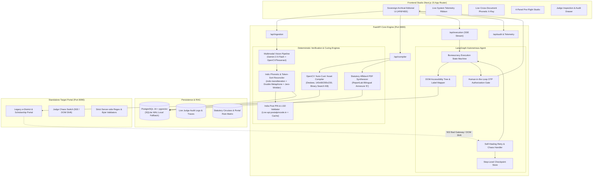
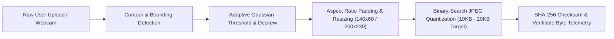
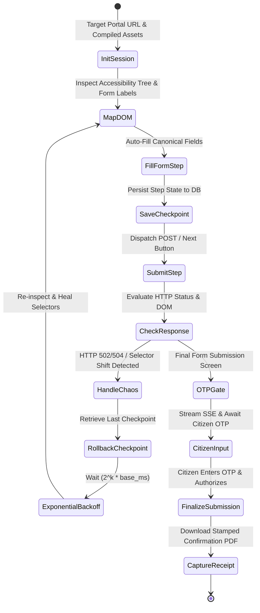

# ZeroReject (PramaanFix) — Technical Architecture & System Design

**Track 1: Civic Pulse, Digital Governance & Public Information (FORGE '26)**

---

## 1. Executive System Overview

ZeroReject (PramaanFix) is an autonomous, deterministic pre-submission audit and bureaucratic auto-curing system designed to eliminate the **>60% failure rate** of citizen and MSME applications on Indian digital governance portals (EPFO, Passport Seva, e-District Caste/Income/Domicile, PM-Kisan, National Scholarship Portal).

Applications primarily fail due to:
1. **Cross-Script & Initial Mismatches** (e.g. Aadhaar in Devanagari `"रमेश कुमार शर्मा"`, PAN card `"RAMESH K SHARMA"`, Marksheet `"Sharma Ramesh Kumar"`).
2. **Address & Pincode Drift** across document formats.
3. **Psychotic Formatting Traps** (pixel aspect ratios, DPI constraints, strict byte windows like `10KB <= signature <= 20KB`).
4. **Government Portal Flakiness** (`502 Bad Gateway` / `504 Gateway Timeout` wiping multi-step entries).

### Core Principle
> **"LLMs Reason & Explain; Deterministic Tools Compute."**
All phonetic similarity, initial expansion, transliteration, pixel metrics, byte compression, and statutory rule validation are executed strictly by deterministic Python engines producing verifiable audit objects `{ value, threshold, passed, formula_used, source_statute, timestamp_utc }`.

---

## 2. High-Level System Architecture

---

## 3. Deterministic Indic Phonetic Reconciler

The reconciler takes names across different document entities and evaluates matching through an explainable multi-metric ensemble:

1. **Indic Transliteration**:
   Uses `indic-transliteration` (SLP1/HK/ISO-15919) to normalize Devanagari and other regional scripts into canonical Latin phonetic tokens:
   $$\text{"रमेश कुमार शर्मा"} \rightarrow \text{"Ramesh Kumar Sharma"}$$

2. **Honorific Normalization**:
   Removes bureaucratic prefixes/titles: `Shri`, `Smt`, `Late`, `Mohd`, `Md`, `Kr`, `Kumari`, `Dr`.

3. **Weighted Phonetic & Levenshtein Ensemble**:
   - **Double Metaphone**: Computes primary and secondary metaphone phonetic keys to catch spelling drift (`"Chaudhari"` vs. `"Choudhury"`).
   - **Jaro-Winkler Distance**: Rewards shared prefixes (`"Ramesh"` vs. `"Rameshwar"`).
   - **Token Sort & Token Set Levenshtein Ratio**: Invariant to word order inversions (`"Sharma Ramesh Kumar"` vs. `"Ramesh Kumar Sharma"`).
   - **Initial Expansion Heuristic**: Detects single-letter initials matching full tokens (`"R."` matches `"Ramesh"`).

4. **Composite Rejection Risk Score**:
   $$\text{Risk Score} = 100 - \left( 0.35 \cdot S_{\text{name}} + 0.20 \cdot S_{\text{father}} + 0.20 \cdot S_{\text{dob}} + 0.15 \cdot S_{\text{address}} + 0.10 \cdot S_{\text{format}} \right)$$

---

## 4. OpenCV Auto-Cure Document & Biometric Asset Compiler

Government portals enforce rigid byte ceilings and pixel dimensions (e.g., photo: $200 \times 230\text{ px}$, $10\text{–}50\text{ KB}$; signature: $140 \times 60\text{ px}$, $< 20\text{ KB}$, grayscale).

The binary-search compression routine iterates over JPEG quality $Q \in [10, 95]$:
- If `size > max_kb`: $Q_{\text{high}} = Q_{\text{mid}} - 1$
- If `size < min_kb` and can increase: $Q_{\text{low}} = Q_{\text{mid}} + 1$
- Halts when `min_kb <= size <= max_kb` or convergence within tolerance.

---

## 5. LangGraph Self-Healing Playwright State Machine

The Playwright execution agent automates filing while handling real server crashes:

---

## 6. Zero Mock Data Architecture & Verification

To comply with the Hackathon Hard Rules:
1. **Live OCR Ingestion**: Every document uploaded goes through real multimodal parsing (Gemini 2.5 Flash if API key provided, or local Tesseract OCR + OpenCV contour detection).
2. **Live India Post PIN Validation**: Actual HTTP GET queries to `https://api.postalpincode.in/pincode/{pin}` returning real post office names, talukas, and districts.
3. **Live Database Traces**: SQLAlchemy asynchronously executes and logs real queries in SQLite (WAL mode) / PostgreSQL.
4. **Live Target Portal on Port 8090**: A fully functional government portal running with real cookies, sessions, CSRF, and byte-level validation.
